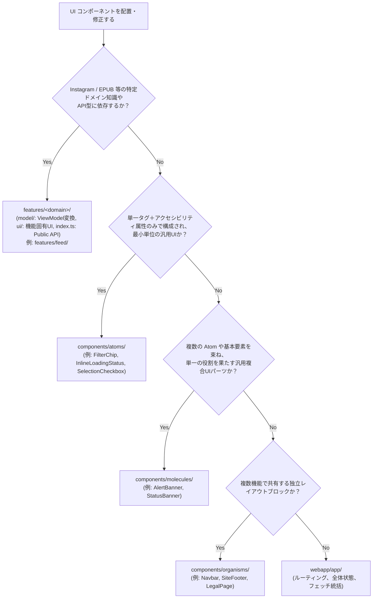

# アトミックデザイン コンポーネント実装・修正 SOP

## Overview

`webapp/` 配下のフロントエンド UI コンポーネントを新規作成・改修・共通化する際の必須手順（Standard Operating Procedure）を定義します。
Next.js App Router（`webapp/app/` = Pages 層）を前提に、**Feature-First × アトミックデザイン（ハイブリッド構成）** として、汎用 UI 層（`src/components/{atoms,molecules,organisms}`）と機能ドメイン垂直スライス（`src/features/<domain>/{model,ui,index.ts}`）の責務境界、依存方向（下位層への単方向依存）、アクセシビリティ、および 1:1 単体テスト実装の基準を担保します。

## Steps

### 1. 配置判断フローとレイヤー定義

コンポーネントやプレゼンターを作成・変更する際は、以下の判断フローに従って配置ディレクトリを決定します。



#### 各層の責務と制約

1. **Layer 1: Atoms (`webapp/src/components/atoms/`)**
   - **責務**: これ以上分解できない最小単位の汎用 UI 要素。
   - **制約**:
     - **ドメイン知識を持たない（MUST）**: 特定のビジネスモデル（`FeedPostItem` や `EpubCustomSettings` など）に依存した Props を受け取らないこと。汎用的なプリミティブ型（`string`, `number`, `boolean`, コールバック関数等）のみを受け取る。
     - **セマンティクスとアクセシビリティの完結（MUST）**: `aria-pressed`, `role="status"`, `role="checkbox"` 等の WAI-ARIA 属性を適切にカプセル化する。
     - **タップ領域（MUST）**: モバイル操作を前提とし、インタラクティブ要素は最低 44px（`min-h-[44px]`）のタップ領域を確保する。

2. **Layer 2: Molecules (`webapp/src/components/molecules/`)**
   - **責務**: 複数の Atoms や基本要素を組み合わせた、ドメイン非依存の単一目的複合 UI パーツ。
   - **制約**:
     - **単一責務の維持（MUST）**: 画面全体のレイアウトや無関係な機能（例: フィルター条件と投稿一覧の混在）を抱え込まないこと。
     - **API / ドメイン型への非依存（SHOULD）**: 特定機能専用のカードやセレクタは `features/<domain>/` へ切り出す。

3. **Layer 3: Features (`webapp/src/features/<domain>/`)**
   - **責務**: 特定機能（例: `features/feed/`）に閉じたプレゼンター（`model/`）と UI 群（`ui/`）を垂直スライスとして管理する。
   - **制約**:
     - **API 構造と表示 Props の分離（SHOULD）**: `model/` のプレゼンター（例: `toPostCardViewModel`）で API 寄りの型を表示専用 ViewModel に変換し、末端 UI（`PostCard`, `PostThumbnail` 等）に API 構造を持ち込まない。
     - **セクション単位の合成（MUST）**: `PostCard` 等が肥大化する場合は、意味単位の小さなプレゼンテーション部品（`PostThumbnail`, `PostMetaHeader`, `CarouselPhotoStrip` 等）へ分割し、`return` 内で全体構成が一望できる宣言的コードにする。
     - **Public API 限定（MUST）**: 外部（`app/` 等）からは `features/<domain>/index.ts` が公開するシンボルのみを import し、下位層（`components/`・`lib/`）から `features/` への逆方向依存を禁止する。

4. **Layer 4: Organisms (`webapp/src/components/organisms/`) & Pages (`webapp/app/`)**
   - **Organisms**: 共通レイアウトブロック（`Navbar`, `SiteFooter`, `LegalPage` 等）および移行中の既存ステップ。
   - **Pages (`webapp/app/`)**: Next.js App Router のページ。全体の状態管理、データ取得、Feature / Organisms のオーケストレーションを担う。

---

### 2. ディレクトリ構成とバレルエクスポート規約

新しいコンポーネントを追加した場合は、各層のバレルファイル（`index.ts`）に登録します。

- `webapp/src/components/atoms/index.ts`: すべての Atom コンポーネントおよび Props 型をエクスポートする。
- `webapp/src/components/molecules/index.ts`: すべての Molecule コンポーネント、Props 型、および関連する純粋関数・定数をエクスポートする。
- `webapp/src/components/organisms/index.ts`: すべての Organism コンポーネントおよび Props 型をエクスポートする。

---

### 3. 単体テスト実装規約（`vitest-test-authoring` 準拠・完全コロケーション）

Atoms、Molecules、および Organisms の全コンポーネントは、保守性と検索性を最大化するため**「1コンポーネント = 1テストファイル（`[ComponentName].test.tsx`）」の 1:1 コロケーション（同ディレクトリ同名配置）を必須（MUST）**とします。

- **テストファイル配置（Colocation）**:
  - 各 `.tsx` コンポーネントファイルの真横に `[ComponentName].test.tsx` を配置する（例: `FilterChip.test.tsx`, `PostCard.test.tsx`, `Navbar.test.tsx` 等）。
  - 1つのテストファイルに複数コンポーネントを集約するアンチパターンは禁止する。
- **パラメータ化テストの義務化（`it.each`）**:
  - 表示状態（アクティブ/非アクティブ、件数あり/なし、disabled/readOnly 等）のバリエーションは `it.each` で網羅する。
- **日本語表記規約**:
  - すべての `describe` / `it` は日本語で仕様書として読めるように記述する。
- **HTML 属性のアサーション**:
  - Tailwind クラスの `disabled:*` と HTML 属性の `disabled=""` の誤判定を避けるため、属性検証時は `disabled=""` または厳格なセレクタを用いる。

---

### 4. 機械的品質ゲートとセルフレビューチェックリスト

変更作業を完了する前に、以下のコマンドを実行しすべて 0 件エラーで通過することを確認します。

```bash
# 1. 単体テスト実行
pnpm test

# 2. 静的解析（Oxlint）
pnpm lint

# 3. コードフォーマット検証（Oxfmt）
pnpm format:check

# 4. TypeScript 型チェック
pnpm --filter instagram-feed-epublisher-webapp exec tsc --noEmit
```

#### セルフレビューチェックリスト

- [ ] Atom にビジネスロジックやドメイン全体の型を直接渡していないか？
- [ ] ボタン・チップ等の操作要素に 44px（`min-h-[44px]`）のタップ領域が確保されているか？
- [ ] `aria-pressed`, `role="status"`, `role="alert"` などの WAI-ARIA 属性が適切に設定されているか？
- [ ] 各ディレクトリの `index.ts` から公開されているか？
- [ ] 既存の E2E ロケータ（Playwright POM）に破壊的変更を与えていないか？
